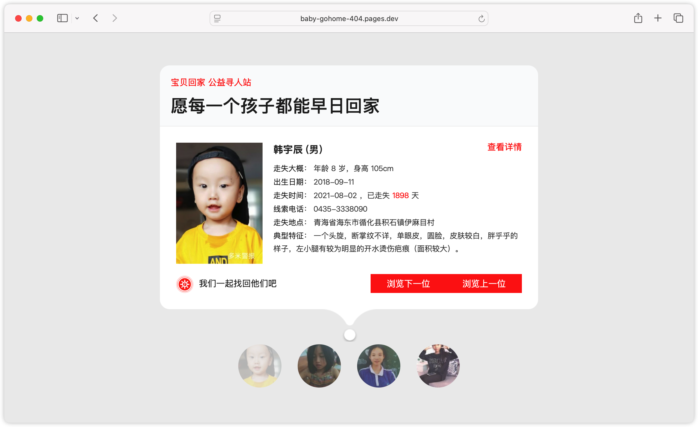

# Baby-Gohome-404 公益寻人站

> 一个基于 dnpw.org 404 公益联盟深度改造的走失儿童信息展示站。纯静态、零依赖、开箱即用。

**这是一个非营利公益项目**：不收集任何访客数据、不接受任何捐赠、不投放任何广告。每一次部署，都是一场爱心接力——星火虽微，聚而成炬。多一个站点亮起，走失的孩子就多一分被看见、被找到的希望。



---

## 项目背景：什么是 404 公益寻人

上网时你可能遇到过这种页面：点开一个链接，提示「您访问的页面找不到了」——这就是 **404 页面**，它只在你访问了一个不存在的地址时才会出现。

[404 公益联盟（dnpw.org）](https://www.dnpw.org/404)的思路是：反正访客点错链接时总会看到一个错误页，不如把这个错误页利用起来——换成一位走失儿童的照片和寻人信息，让每一次「迷路」都变成一次寻人曝光，为线索直达「宝贝回家」官网。

这个创意很好，但它有个天然短板：**404 是异常路径，正常网站一年也触发不了几次**。寻人页挂在它后面，曝光效率趋近于零，很多站长部署后几乎从未被看到过。

## 本项目的思路：把偶然变成必然

本项目的做法是把这套模式反过来用——**不把寻人页藏在 404 后面，而是专门部署一个网站，主页直接就是寻人展示页**。这样无论访客怎么进来，都一定会看到走失儿童的信息，「偶然的曝光」就变成了「每一次访问的必见」。

在此基础上，还补上了原版没有的翻页、批次回看、无刷新换批等功能，让它不只是一个摆设，而是一个真正能让人逐位浏览、随时回看的寻人展位。

## 与原版 404 公益的区别

| 对比项 | 原版 404 公益 | 本项目 |
|---|---|---|
| 展示时机 | 仅 404 错误页触发（极低频） | **首页常驻展示，每次访问必见** |
| 浏览方式 | 无法翻页，看过即止 | 「浏览上一位 / 浏览下一位」逐位切换 |
| 回看能力 | 无——换批即丢失，感兴趣的线索回不去 | **批次历史栈：可精确回看浏览过的每一批每一个人** |
| 换批方式 | 整页重载（白屏闪烁） | 无刷新静默换批 |
| 数据范围 | 每次随机 4 位，无法控制 | 4 位一批，无限延伸，双向穿梭 |
| 部署门槛 | 需自行集成 | 纯静态，开箱即用 |

## 功能特性

- **必然展示**：主页即寻人页，不依赖 404 触发（`404.html` 同时提供，兼容传统 404 场景接入）
- **翻页浏览**：在同批 4 位走失儿童之间逐位切换，底部缩略图同步高亮
- **批次回看**：换批后旧批次保留在内存，「浏览上一位」可精确回到上一批的末位，双向来回穿梭不丢人
- **无刷新换批**：浏览到最后一位再点「下一位」，后台静默拉取新一批（联盟接口每次随机返回，实测连续请求不重样），页面不闪
- **线索直达**：「查看详情」与儿童照片点击均跳转「宝贝回家」官网对应帖子
- **零维护**：渲染脚本、寻人数据、图片全部由公益联盟 CDN 动态提供，部署后无需任何后续维护

## 部署指南

纯静态项目，零构建、零依赖，三种方式任选：

### 方式一：腾讯云 EdgeOne Makers

1. Fork 或下载本仓库
2. 登录 EdgeOne Makers 控制台，创建项目并绑定你的 GitHub 仓库
3. 部署命令留空（纯静态无构建），push 自动上线
4. 绑定自定义域名即可

### 方式二：Cloudflare Pages

推荐使用 Cloudflare Pages 的免费托管：Fork 本仓库后，在 Pages 中连接仓库，零配置完成部署，后续 push 自动更新。

### 方式三：其他静态托管平台

任何支持静态网页托管的平台均可，将仓库文件导入或上传即可完成部署。传统网站还可以把 `error_page 404` 指向 `404.html`，让 404 兜底场景同样展示寻人信息。

## 自定义

编辑 HTML 中的 `<script>` 标签参数：

```html
<script src="//cdn.zhaolinlang.com/cdn.dnpw.org/404/v3.min.js"
  maincolor="#f00"          <!-- 主题色 -->
  tips="宝贝回家 公益寻人站"   <!-- 页面短提示（同时会成为浏览器标签页标题） -->
  error="愿每一个孩子都能早日回家"  <!-- 页面长提示 -->
  jumptime="-1"             <!-- 自动跳转秒数，-1 = 不自动跳转 -->
  jumptarget="/"            <!-- 自动跳转目标 -->
  charset="utf-8"></script>
```

页面预留了联盟官方的 `diy()` 扩展函数（页面加载完成后执行，可自由修改页面元素）。本项目的翻页/回看功能就是通过它实现的，源码在 `index.html` 内有完整注释，可自行调整按钮文案或行为。

## 目录结构

```
├── index.html   # 主页：寻人展示 + 翻页（部署者主要使用这个）
├── 404.html     # 404 错误页版本（内容与主页一致，供 error_page 场景接入）
├── LICENSE
└── README.md
```

## 致谢与声明

- **寻人数据与渲染脚本**：[dnpw.org 404 公益联盟](https://www.dnpw.org/404)提供，本项目仅做展示层增强
- **寻亲线索**：「查看详情」跳转[宝贝回家](https://www.baobeihuijia.com/)官网
- 本项目**纯公益、不盈利**；使用本项目的部署者请同样**仅限公益用途**，请勿用于商业或广告场景
- 代码部分以 [MIT License](LICENSE) 开源

---

*愿每一个孩子都能回家。能出一分力是一分力。*
